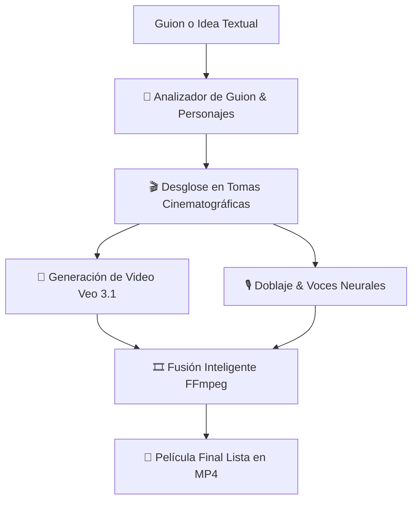

# 🎬 Hey Milo AI — Estudio de Producción de Video & Cine con IA

<p align="center">
  
</p>

<p align="center">
  <strong>Tu Productor, Director y Editor Audiovisual Autónomo impulsado por Google Veo 3.1 & Nano</strong>
</p>

<p align="center">
  
  
  
  
  
  
</p>

---

## 🌟 ¿Qué es Hey Milo AI?

**Hey Milo AI** es una plataforma SaaS integral creada para creadores de contenido, directores, cineastas y agencias que automatiza el proceso completo de producción cinematográfica:

1. **Transforma texto o guiones en películas continuas.**
2. **Mantiene consistencia total de personajes** (rostro, vestimenta, peinado y voz escena tras escena).
3. **Genera video cinematográfico ultra realista** conectándose a los modelos más avanzados de **Google Veo 3.1 & Nano**.
4. **Sintetiza voces neuronales de alta fidelidad** con acentos naturales en español (Colombia, México, España, etc.).
5. **Ensambla automáticamente todo el material con FFmpeg** para exportar la película final en alta definición lista para redes (TikTok, Reels, Shorts) o formato Cine YouTube (16:9).

---

## 💰 Modelo de Cobro por Minuto (Pay-Per-Minute)

* **Pack Creador Starter:** 15 Minutos de video ($3 USD / ~$0.20/min).
* **Pack Creador Pro:** 60 Minutos de video ($6 USD / ~$0.10/min) ⭐ *Más Popular*.
* **Pack Estudio Cine:** 180 Minutos de video ($10 USD / ~$0.05/min).
* **Medición precisa:** 1 escena de 8 segundos descuenta únicamente 0.13 minutos.

---

## ⚡ Flujo de Trabajo (¿Cómo funciona?)



### 1. Desglose de Guion & Consistencia de Personajes
El motor de IA analiza el guion recibido, identifica automáticamente a los personajes clave (rostro, rasgos, atuendos) y desglosa la historia en escenas estructuradas con:
- **Ángulo de cámara:** Primer plano, plano general, contrapicado, travelling.
- **Iluminación & Estética:** Iluminación volumétrica, 35mm cinematográfico, paleta de colores.
- **Diálogos:** Separados por personaje con emociones asignadas.

### 2. Motor de Video (Google Veo 3.1 / Nano Banana)
Utiliza la integración automatizada con Google Flow para renderizar cada plano con físicas realistas, movimientos de cámara estables y renderizado fotorrealista.

### 3. Locución & Doblaje Neuronal
Convierte cada línea de diálogo en pistas de audio limpias usando voces neuronales multicéntricas:
- 🇨🇴 **Salomé & Gonzalo** (Colombia - Emotiva y Firme)
- 🇲🇽 **Dalia & Jorge** (México - Clara y Profunda)
- 🇪🇸 **Elvira & Álvaro** (España - Madura e Intensa)

### 4. Montaje Automatizado con FFmpeg
Une todos los fragmentos renderizados en orden secuencial, fusionando las pistas de voz y exportando un video unificado sin marcas de agua.

---

## 🛠️ Tecnologías y Arquitectura

* **Frontend:** Next.js 16 (App Router), React, Tailwind CSS, Lucide Icons, Framer Motion aesthetics.
* **Backend:** Next.js Route Handlers (Serverless/Node.js).
* **Base de Datos & Auth:** Base de datos modular y liviana en JSON/SQLite con sesiones seguras vía cookies HTTPOnly y encriptación de claves (PBKDF2/SHA-256).
* **Motor de Video:** CLI de Google Flow (`gflow-cli`) ejecutando generación sobre los endpoints de Google Veo.
* **Motor de Voz:** `edge-tts` con streaming en tiempo real.
* **Motor de Render:** `FFmpeg` nativo para concatenación demuxer y sincronización audiovisual.

---

## 🚀 Requisitos Previos

Antes de instalar, asegúrate de tener instalado en tu computadora:

1. **Node.js 20 LTS o superior** ([Descargar](https://nodejs.org/))
2. **Python 3.10 o superior** ([Descargar](https://www.python.org/))
3. **FFmpeg** instalado y disponible en tu `PATH` del sistema.
4. **Navegador Brave o Google Chrome** (para la autenticación inicial de Google Flow).

---

## 📦 Instalación y Puesta en Marcha

### 1. Clonar el repositorio
```bash
git clone https://github.com/Fatxl25/Heymilo-IA.git
cd Heymilo-IA
```

### 2. Instalar dependencias de Node.js
```bash
npm install
```

### 3. Instalar herramientas de voz y video en Python
```bash
pip install edge-tts gflow-cli
```

### 4. Iniciar en modo desarrollo
```bash
npm run dev
```

Abre tu navegador en [http://localhost:3000](http://localhost:3000).

---

## 🎮 Cómo Usar la Plataforma

1. **Iniciar Sesión:**
   * La plataforma viene configurada con una cuenta **Administrador Master**:
     * **Email:** `edinsonpc01@gmail.com`
     * **Contraseña:** `admin123`
   * Los nuevos visitantes pueden registrarse y acceder al creador activando su Pase Creador.

2. **Escribir el Guion:**
   * En el panel central, escribe tu historia o escena (ej: *"Valentina entra al laboratorio secreto y descubre el holograma de Alejandro..."*).

3. **Desglosar en Tomas:**
   * Haz clic en **"Desglosar en Tomas"**. La IA creará los personajes y la lista de escenas con sus respectivos prompts cinematográficos.

4. **Sintetizar Voces:**
   * En cada toma, reproduce y genera los diálogos con las voces neuronales seleccionadas.

5. **Generar la Película:**
   * Presiona **"Generar Película Completa"**. Hey Milo procesará los clips y los ensamblará automáticamente en un único video descargable en la pestaña **Galería / Renders**.

---

## 📁 Estructura del Código

```text
flowstudio-pro/
├── app/
│   ├── api/
│   │   ├── auth/           # Registro, Login, Sesiones y Roles
│   │   ├── flow/           # Conector con Google Flow (Veo 3.1)
│   │   ├── movie/          # Ensamblaje de película con FFmpeg
│   │   ├── payment/        # Checkout y verificación de pagos
│   │   ├── renders/        # Listado de medios generados
│   │   ├── storyboard/     # Motor de IA para creación de guiones y tomas
│   │   └── voice/          # Síntesis de voz con Edge-TTS
│   ├── renders/[filename]/ # Streaming dinámico de videos y audios
│   ├── globals.css         # Diseño visual, gradientes y animaciones
│   ├── layout.tsx          # Layout maestro
│   └── page.tsx            # Interfaz de usuario interactiva y estudio de cine
├── lib/
│   ├── auth-server.ts      # Verificación de credenciales y middleware
│   ├── db.ts               # Capa de base de datos de usuarios y transacciones
│   ├── ffmpeg.ts           # Utilidades para corte y unión de videos
│   └── gflow.ts            # Automatización y control de Google Flow
├── public/                 # Recursos estáticos y renders exportados
└── start-studio.bat        # Lanzador rápido de 1 clic para Windows
```

---

## 📄 Licencia

Este proyecto está bajo la Licencia **MIT**. Eres libre de usarlo, modificarlo y desplegarlo tanto para uso personal como comercial.
